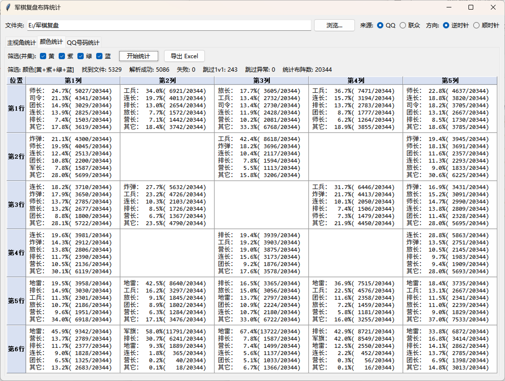
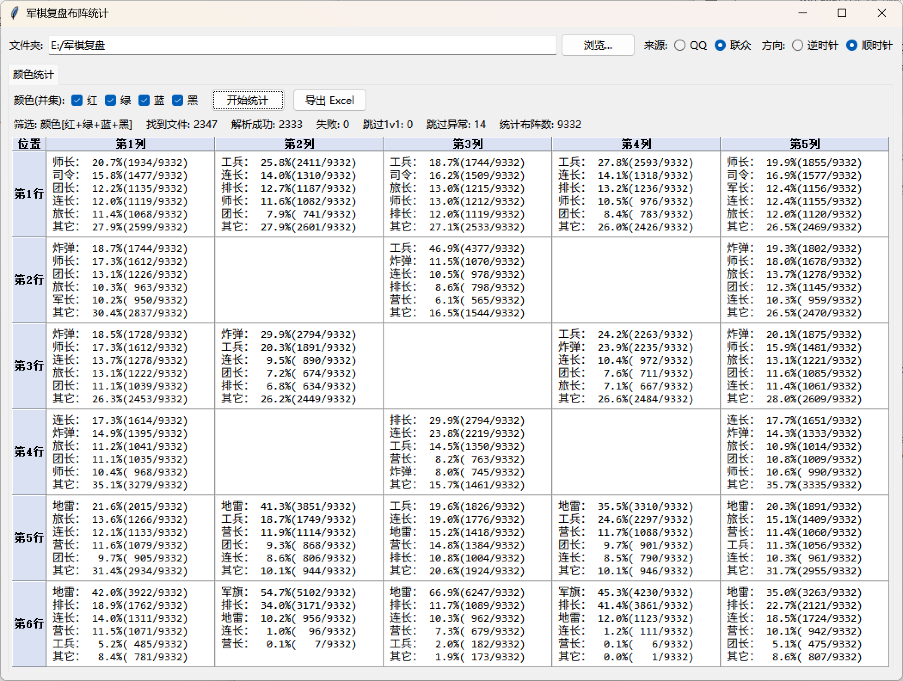

本程序基于以下项目进行二次开发
  
https://github.com/windsgo/myjgs

感谢 [windsgo](https://github.com/windsgo) 的先行工作！

当前已支持内容：

* [x] QQ复盘文件(.jqh)的四家布阵内容解析（源项目已经实现，本工程仅作python重写）
* [x] 联众军棋复盘文件(.jqh)的四家布阵内容解析
* [x] 布阵统计

待实现：

* [ ] QQ复盘文件对局全内容解析
* [ ] 联众复盘文件对局全内容解析

程序运行效果如下：

