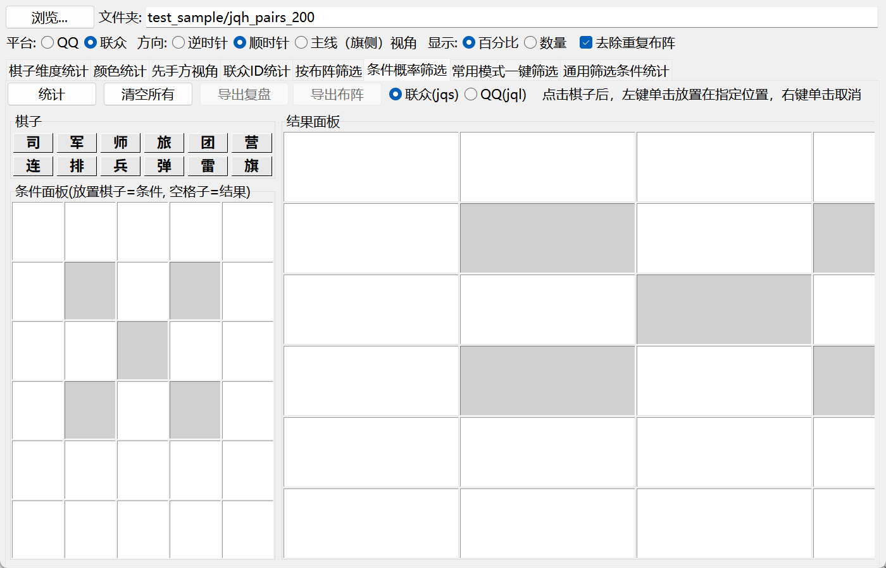
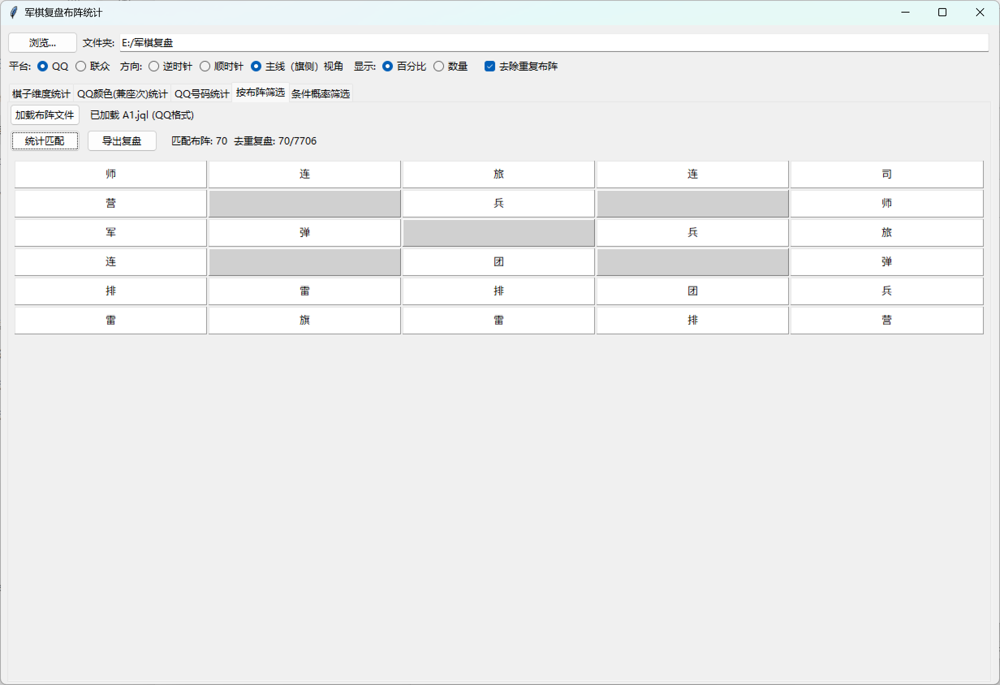
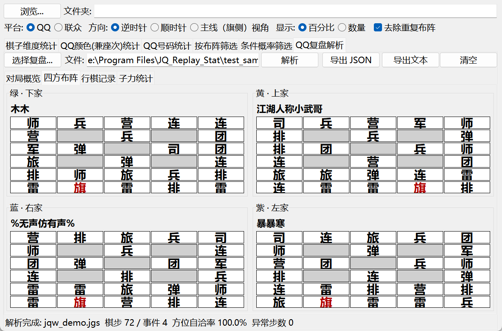
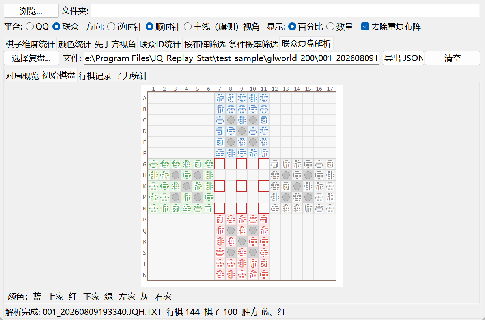

# 军棋复盘解析及统计

[github下载地址](https://github.com/math-yyj/JQ_Replay_Stat/releases/tag/v0.2.3)

[百度网盘分流下载地址](https://pan.baidu.com/s/1l7ONXQTezOhxzpIPrCWM_w?pwd=aitd)

感谢 [@windsgo](https://github.com/windsgo) 的[先行工作](https://github.com/windsgo/myjgs)！

## 运行效果










## 已支持功能

* [x] QQ复盘文件(.jgs)的四家布阵内容解析
* [x] QQ复盘文件完整对局解析（方位推导/行棋结算/子力得失）
* [x] QQ复盘批量条件统计（四色×12棋子、17×17棋盘、首次/全部快照）
* [x] 联众军棋复盘文件(.jqh)的四家布阵内容解析
* [x] 联众文本复盘(.JQH.TXT)完整对局解析（行棋推演/子力得失/评级）
* [x] 布阵统计（多维度筛选）
* [x] 棋子维度统计（12选1单选）
* [x] 主线（旗侧）视角统计
* [x] 布阵数据校验（空位/非法编码/缺军旗/空布阵）
* [x] 条件概率筛选（拖拽式棋子放置 + 频率分析）
* [x] 按布阵文件筛选（加载 .jqs/.jql 直接比对复盘）
* [x] QQ号码白名单/黑名单筛选
* [x] 联众ID白名单/黑名单筛选
* [x] 去除重复布阵
* [x] 百分比/数量显示模式切换
* [x] 联众用户名解码（XOR累积加密）
* [x] 联众主视角颜色解码
* [x] 导出布阵/导出复盘双通道导出

## 统计面板

程序提供以下统计面板，根据平台（QQ/联众）自动显示：

| 面板 | QQ模式 | 联众模式 | 说明 |
|------|--------|----------|------|
| 棋子维度统计 | 显示 | 显示 | 12选1单选，只统计选中棋子在各位置的出现频率 |
| QQ颜色(兼座次)统计 | 显示 | - | 按颜色/座次筛选（红先手位/紫二号位/绿三号位/蓝四号位） |
| QQ号码统计 | 显示 | - | 白名单/黑名单筛选特定玩家，支持导出复盘 |
| 联众颜色统计 | - | 显示 | 联众模式按红/绿/蓝/黑筛选 |
| 联众先手方视角 | - | 显示 | 按座次(先手位/二号位/三号位/四号位)统计 |
| 联众ID统计 | - | 显示 | 按用户名白名单/黑名单筛选，支持导出复盘 |
| 按布阵筛选 | 显示 | 显示 | 加载布阵文件直接比对复盘，支持导出复盘 |
| 条件概率筛选 | 显示 | 显示 | 拖拽式棋子放置，频率分析，支持导出布阵/复盘 |
| QQ复盘解析 | 显示 | - | 选择单份 .jgs，解析四方布阵、行棋/事件与子力得失，支持导出 JSON/文本 |
| QQ复盘批量统计 | 显示 | - | 四色×12棋子条件，17×17条件/结果棋盘，支持首次或全部满足快照 |
| 联众复盘解析 | - | 显示 | 选择单份 .JQH.TXT，解析玩家、17×17棋盘、行棋/交手、净值与评级 |

**平台切换时选项卡自动对应，不会跳变。**

## 方向与镜像

提供三种方向选项：

| 方向 | 说明 |
|------|------|
| 逆时针 | QQ模式默认。不镜像显示 |
| 顺时针 | 联众模式默认。镜像显示（列顺序翻转） |
| 主线（旗侧）视角 | 将军旗位于右侧大本营的布阵镜像翻转后叠加到左侧统计，实现旗侧归一化视角 |

**镜像规则：**
- QQ模式：逆时针=不镜像，顺时针=镜像
- 联众模式：顺时针=不镜像，逆时针=镜像
- 主线模式：始终不镜像（内部已处理左右旗合并）

## 统计结果显示

- 每个格子显示棋子出现频率，按百分比降序排列
- 双列显示：top1 top2 / top3 top4 / ...
- 颜色渐变：top1=红, top2=暗红, top3=更暗红, 其它=黑
- 支持百分比/数量两种显示模式切换
- 行营位置显示为灰色空白
- 统计摘要同时显示去重布阵数和去重复盘数

## 按布阵筛选

- 加载 .jqs（联众）或 .jql（QQ）布阵文件
- 直接逐格比对复盘布阵，不做顺逆时针/旗侧视角镜像
- 支持导出匹配的复盘文件（按文件去重）

## 条件概率筛选

### 布局
- **左侧**：棋子栏（2x6），点击选中棋子
- **中间**：条件面板（6x5），放置棋子作为筛选条件
- **右侧**：结果面板（6x5），显示匹配布阵的频率分布

### 操作
- 点击左侧棋子选中（RadioButton行为，同时只能选中一个）
- 左键点击条件面板格子放置棋子
- 右键点击条件面板格子移除最后放置的棋子

### 格子限制
- 第0行：3x3格子，只能放司军师旅团营连排兵
- 第1-3行：4x3格子，可放除雷旗外的所有棋子
- 第4-5行：4x3格子，可放所有12种棋子

## QQ复盘完整解析

在“QQ复盘解析”选项卡中选择单份 `.jgs` 文件，可查看：

- **对局概览**：己方颜色、四方方位/座位、行棋顺序、方位自洽率、胜负结果、数据异常步数、关键事件。
- **四方布阵**：四家 6x5 布阵，行营灰显，军旗红字。
- **行棋记录**：逐步显示颜色、起止坐标、结算结果、关键事件和本步子力变化。
- **子力统计**：步数、吃子、被吃、同尽、炸杀、中炸、挖雷、扛旗、触雷、失着、得分、损失、净值。

方位不再固定为默认值：程序枚举 24 个“颜色→方位”双射，按行棋起点与铺盘状态的自洽率选最优解，再用玩家块颜色字节做平票兜底。行棋结算覆盖吃子、被吃、同尽、炸杀、中炸、挖雷、触雷、扛旗，以及超时判负、战败、退出、连续两次未行棋判负。

解析结果可导出为完整 JSON，或导出为“QQ四国军棋复盘 v2.0”文本。命令行同样可用：

```bash
python -m src.qq_replay <复盘.jgs>
python -m src.qq_replay <复盘.jgs> --json 结果.json --text 复盘v2.txt
```

## QQ复盘批量统计

在“QQ复盘批量统计”选项卡中，以文件夹内全部 `.jgs` 为样本：

- 左侧为四色×12棋子条件，可拖拽或点击选择。
- 中间条件棋盘统一为“黄上/紫左/绿下/蓝右”。可移动棋子全盘可选（含行营、九宫、大本营），军旗限己方大本营，地雷限己方后两排。
- 同一格内多个棋子按“或”判断，不同格子之间按“且”判断。
- 右侧结果棋盘默认全部关闭，左键点亮需要输出的格子。
- 支持“仅统计首次满足快照”；取消后统计全部满足快照，并按点亮区域的连续状态去重，避免静止区间重复计数。

## 联众复盘完整解析

在“联众复盘解析”选项卡中选择单份 `.JQH.TXT` 文本复盘，可查看：

- **对局概览**：玩家、座位、先手方、对局信息、净值、评级、胜负和关键事件。
- **初始棋盘**：17×17 棋盘，按蓝上/红下/绿左/灰右着色，行营与大本营单独标记。
- **行棋记录**：逐步显示行棋类型、起止坐标、回合方、实际行棋方、交手双方与结果。
- **子力统计**：步数、交手、吃子、被吃、同尽、炸杀、被炸、挖雷、触雷、得分、损失、净值和 S/A/B/C/D 评级。

文本按 GB18030 解码；二进制 `.jqh` 文件不在网页版支持范围内，本工具会提示改用 `.JQH.TXT`。

## 数据校验

QQ复盘布阵校验规则：
- 非行营位置出现空位(JQNone) → 标记异常
- 非行营位置出现未知棋子编码 → 标记异常
- 布阵缺少军旗 → 标记异常
- 四家布阵不全（非1v1且非4家） → 标记异常

## 其他行为

- 切换文件夹或切换平台时，所有统计结果自动清空
- 切换方向时，保留已有统计结果，仅重新渲染（镜像翻转）
- 切换百分比/数量显示模式时，无需重跑统计
- 统计过程中动态显示进度（已处理/总数）
- 异常复盘合并提示，每类最多列10个文件名
- 去除重复布阵默认开启
- 所有对话框绑定父窗口，防止窗口缩小

## 待实现

* [ ] 联众二进制 `.jqh` 复盘直接解析（当前完整解析使用 `.JQH.TXT` 文本）

## 第三方资源与免责声明

`third_party/jqw_replay/` 和 `third_party/jqw_replay_glworld/` 分别是来源网页 [http://www.junqiwang.cn/qq.html](http://www.junqiwang.cn/qq.html) 与 [http://www.junqiwang.cn/fp.html](http://www.junqiwang.cn/fp.html) 的本地离线镜像，包含页面及其运行所需的脚本、样式与图标资源，仅用于个人学习、技术分析和离线研究。

- 页面、脚本、样式、图片及相关内容的版权归原网站及原作者所有。
- 本仓库不对上述第三方资源主张任何权利，也未获得商业授权，请勿用于商业用途。
- 来源网页及其内容同样仅供学习分析使用，本仓库与来源网站不存在隶属或合作关系。
- 如权利人认为该镜像侵犯其权益，请联系删除，我们将及时处理。

